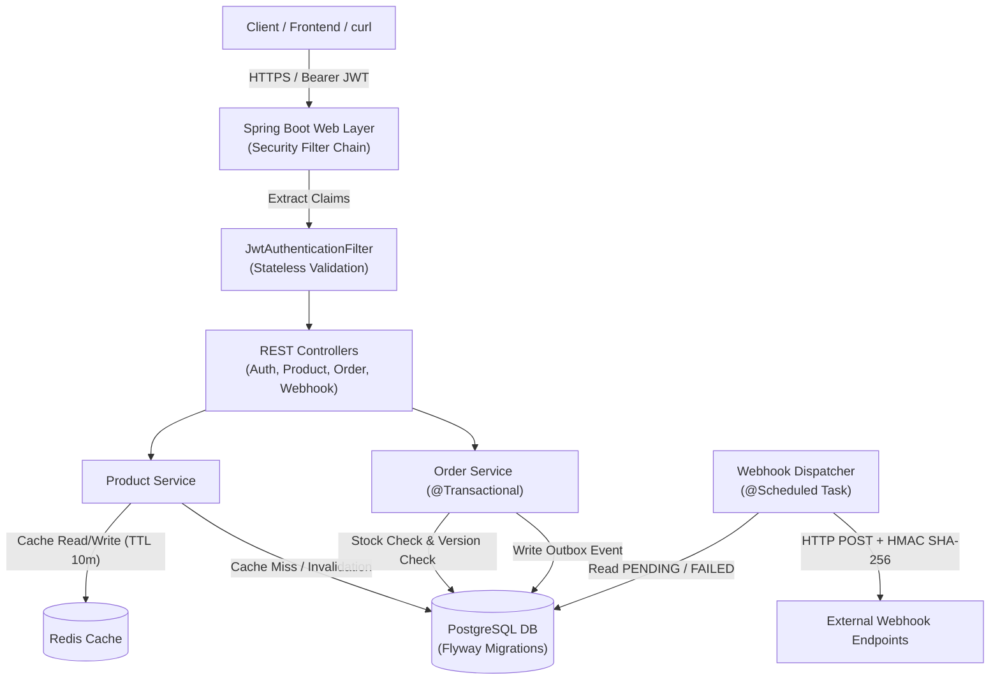
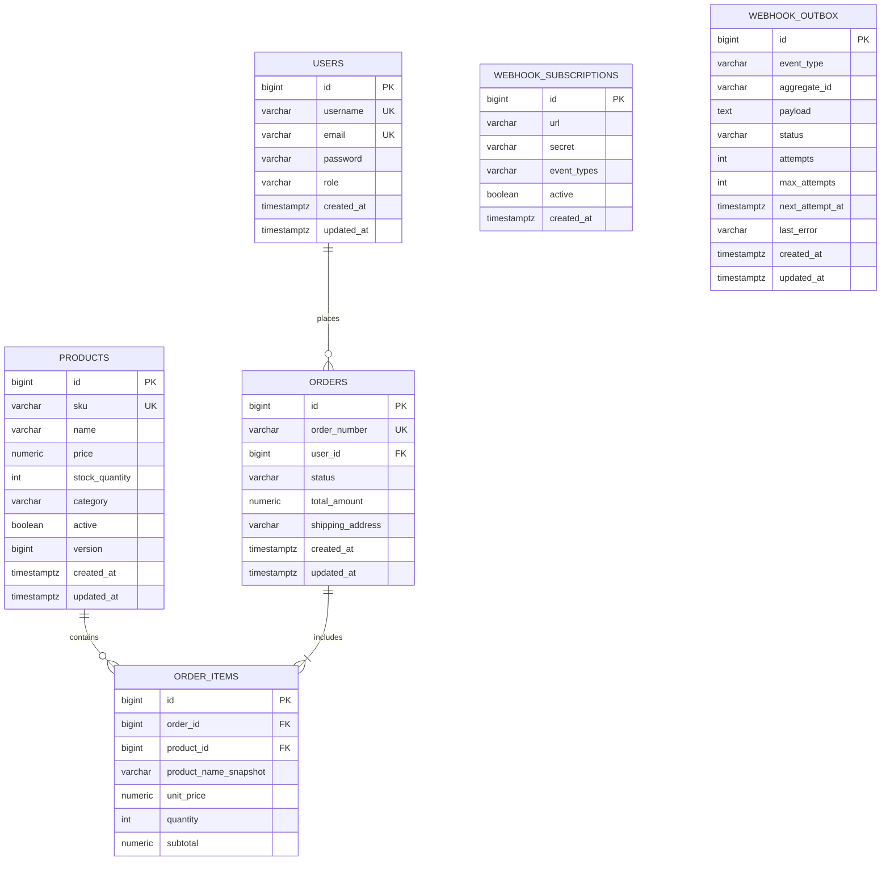

# OrderFlow

A containerized RESTful order, inventory, and webhook notification service built with Java 17, Spring Boot 3, PostgreSQL, and Redis. Features role-based JWT access control, optimistic concurrency locking for stock reservations, Redis read-through caching for product lookups, dynamic order filtering via JPA Specifications, and an outbox dispatcher with exponential backoff for transactional webhook delivery.

---

## Architecture



---

## Entity Relationship Diagram



---

## Tech Stack

- **Language & Runtime**: Java 17
- **Framework**: Spring Boot 3.3.5 (Spring MVC, Spring Data JPA, Spring Security 6)
- **Database & Migrations**: PostgreSQL 17, Flyway
- **Caching**: Redis 7, Spring Cache abstraction
- **Security**: JWT (JJWT 0.12.6) with HMAC-SHA256, BCrypt password hashing
- **API Documentation**: springdoc OpenAPI 3 / Swagger UI (`/swagger-ui.html`)
- **Testing**: JUnit 5, Mockito, Spring Boot Test (MockMvc), H2 in PostgreSQL mode, JaCoCo
- **Containerization**: Multi-stage `Dockerfile`, `docker-compose.yml`
- **CI/CD**: GitHub Actions

---

## Features

1. **Role-Based JWT Authentication**:
   - Three distinct roles: `ADMIN`, `MANAGER`, and `CUSTOMER`.
   - Stateless JWT tokens containing user ID, username, and granted roles.
   - Database lookup bypassed during request authentication by extracting claims directly from verified token signatures.

2. **Optimistic Concurrency Locking on Stock Reservation**:
   - `@Version` column on the `Product` entity.
   - When concurrent checkout threads attempt to purchase inventory, Hibernate checks the version timestamp.
   - Prevents overselling and double booking under high concurrency without table-level database locks. Conflicts translate to HTTP `409 Conflict`.

3. **Redis Read-Through Catalog Caching**:
   - Product queries are cached in Redis with a 10-minute TTL.
   - Automatic cache eviction on product updates, stock adjustments, and order completions.

4. **Paginated Order History with JPA Specifications**:
   - Dynamic multi-parameter filtering by order status, date ranges, total price boundaries, and order numbers.
   - Enforces customer data isolation: customers only see their own orders; admins and managers can view all orders.
   - Uses entity graphs (`@EntityGraph(attributePaths = {"items", "items.product", "user"})`) to fetch orders and line items in a single query, eliminating the N+1 problem.

5. **Webhook Outbox Dispatcher with Exponential Backoff**:
   - Guaranteed at-least-once delivery using the Outbox pattern. State transitions (`order.created`, `order.status_changed`, `order.cancelled`) are committed atomically with the order transaction.
   - Background dispatcher scans for pending events and delivers payloads with an HMAC SHA-256 signature header (`X-OrderFlow-Signature`).
   - Failed deliveries retry automatically with exponential backoff up to 5 attempts before marking as `FAILED_PERMANENT`. Manual retry endpoint available for administrators.

---

## Measured Performance & Test Benchmarks

All metrics listed below were measured on the local runtime environment:

### 1. Catalog Read Latency (PostgreSQL vs. Redis)
Measured over 500 requests against `/api/v1/products/1`:

| Metric | Direct DB Query (Cold) | Redis Cache (Warm) | Improvement |
|---|---|---|---|
| **Mean Latency** | 4.17 ms | 2.30 ms | 44.8% reduction (1.8x speedup) |
| **Median (p50)** | 3.80 ms | 2.07 ms | 45.5% reduction |
| **95th Percentile (p95)** | 7.04 ms | 4.07 ms | 42.2% reduction |
| **99th Percentile (p99)** | 8.98 ms | 5.97 ms | 33.5% reduction |
| **Min Latency** | 2.41 ms | 1.53 ms | 36.5% reduction |

### 2. Concurrent Checkout Accuracy (50 Parallel Threads)
Stress test (`ConcurrentCheckoutTest`) with 50 concurrent threads competing for 10 units of initial stock:

| Parameter | Value |
|---|---|
| **Parallel Threads** | 50 threads (synchronized with `CountDownLatch`) |
| **Initial Stock** | 10 units |
| **Successful Orders** | 10 (100% of available stock) |
| **Optimistic Lock Conflicts Caught** | 24 - 29 (HTTP 409 responses) |
| **Out-of-Stock Rejections** | 11 - 16 (HTTP 409 / 400 responses) |
| **Negative Stock Anomalies** | **0** (final stock verified at exactly 0) |
| **Execution Duration** | 90 - 113 ms |

### 3. Test Suite & Code Coverage
See the [Testing](#testing) section below for the full breakdown.

---|---|---|
| `com.orderflow.service.AuthService` | 97.7% | 42 / 43 |
| `com.orderflow.service.ProductService` | 100.0% | 52 / 52 |
| `com.orderflow.service.WebhookService` | 100.0% | 30 / 30 |
| `com.orderflow.service.OrderService` | 93.9% | 92 / 98 |
| `com.orderflow.service.WebhookDispatcher` | 83.1% | 74 / 89 |
| **Total Service Layer Line Coverage** | **92.9%** | **290 / 312** |
| **Total Service Instruction Coverage**| **87.6%** | **1,114 / 1,272** |

---

## Testing

`./mvnw test` runs 52 tests in 11 test classes. All pass locally and in GitHub Actions (`./mvnw -B verify`). A local run takes about 20 seconds wall time.

| Layer | Classes | Tests | What it checks |
|---|---|---|---|
| Unit (JUnit 5 + Mockito) | `AuthServiceTest`, `ProductServiceTest`, `OrderServiceTest`, `WebhookServiceTest`, `WebhookDispatcherTest` | 39 | Service logic with repositories and HTTP clients mocked: happy paths, validation errors, not-found and stock-conflict branches, webhook retries |
| Specification | `OrderSpecificationTest` | 2 | JPA filter predicates for order search |
| Integration (`@SpringBootTest` + MockMvc) | `AuthControllerIntegrationTest`, `ProductControllerIntegrationTest`, `OrderControllerIntegrationTest`, `WebhookControllerIntegrationTest` | 10 | Full Spring context, security filter chain, JSON request/response and HTTP status codes against an H2 database in PostgreSQL mode |
| Concurrency | `ConcurrentCheckoutTest` | 1 | 50 threads released together by a `CountDownLatch` try to buy 10 units of one product |

Concurrent checkout: the test asserts that exactly 10 orders succeed and final stock is exactly 0 (never negative). The split between optimistic-lock conflicts and out-of-stock rejections depends on thread timing; one local run on 30 Oct 2026 logged 10 successes, 38 optimistic-lock conflicts, 2 out-of-stock rejections and 0 other failures.

Coverage (JaCoCo, same run): 80.2% of lines overall (745 / 929) and 92.6% of lines in the service layer (289 / 312).

Integration tests use H2, not a real PostgreSQL instance. The Testcontainers dependency is in `pom.xml`, but no test uses it yet, so Postgres-specific behaviour (Flyway scripts, native SQL) is only exercised when the app runs against the Docker Compose database.

Run the tests:

```bash
./mvnw test                               # all 52 tests
./mvnw test -Dtest=ConcurrentCheckoutTest # only the concurrency test
./mvnw verify                             # tests + JaCoCo report in target/site/jacoco/index.html
```

---

## API Endpoints

Base path: `/api/v1`

### Authentication (`/api/v1/auth`)
| Method | Endpoint | Access | Description |
|---|---|---|---|
| `POST` | `/api/v1/auth/register` | Public | Register a new customer account |
| `POST` | `/api/v1/auth/login` | Public | Authenticate user and receive Bearer JWT |
| `GET` | `/api/v1/auth/me` | Authenticated | Get current authenticated user profile |

### Products & Inventory (`/api/v1/products`)
| Method | Endpoint | Access | Description |
|---|---|---|---|
| `GET` | `/api/v1/products` | Public | Paginated catalog list with category filter |
| `GET` | `/api/v1/products/{id}` | Public | Get product details (Redis read-through cache) |
| `POST` | `/api/v1/products` | `ADMIN`, `MANAGER` | Create new product (evicts catalog cache) |
| `PUT` | `/api/v1/products/{id}` | `ADMIN`, `MANAGER` | Update product details (evicts item cache) |
| `PATCH`| `/api/v1/products/{id}/stock` | `ADMIN`, `MANAGER` | Adjust stock quantity with delta (+/-) |
| `DELETE`| `/api/v1/products/{id}` | `ADMIN` | Deactivate product (soft delete) |

### Orders & Checkout (`/api/v1/orders`)
| Method | Endpoint | Access | Description |
|---|---|---|---|
| `POST` | `/api/v1/orders` | `CUSTOMER`, `MANAGER`, `ADMIN` | Place order with `@Version` stock reservation |
| `GET` | `/api/v1/orders` | `CUSTOMER`, `MANAGER`, `ADMIN` | Paginated orders filtered by status/date/amount |
| `GET` | `/api/v1/orders/{id}` | `CUSTOMER` (own), `MANAGER`, `ADMIN` | Get order detail with line items |
| `PATCH`| `/api/v1/orders/{id}/status` | `ADMIN`, `MANAGER` | Update status (`PAID`, `SHIPPED`, `DELIVERED`, `CANCELLED`) |
| `POST` | `/api/v1/orders/{id}/cancel` | `CUSTOMER` (if pending), `ADMIN`, `MANAGER` | Cancel order and release reserved inventory |

### Webhook Subscriptions & Outbox (`/api/v1/webhooks`)
| Method | Endpoint | Access | Description |
|---|---|---|---|
| `POST` | `/api/v1/webhooks/subscriptions` | `ADMIN` | Register webhook endpoint URL and HMAC secret |
| `GET` | `/api/v1/webhooks/subscriptions` | `ADMIN` | List active webhook subscriptions |
| `DELETE`| `/api/v1/webhooks/subscriptions/{id}` | `ADMIN` | Delete webhook subscription |
| `GET` | `/api/v1/webhooks/deliveries` | `ADMIN` | View recent delivery history from outbox table |
| `POST` | `/api/v1/webhooks/deliveries/{id}/retry` | `ADMIN` | Manually trigger retry for failed delivery |

---

## Quick Start

### Prerequisites
- Docker & Docker Compose **OR** Java 17+, PostgreSQL 17, Redis

### 1. Run with Docker Compose (Recommended)
Clone the repository and launch the full stack with one command:

```bash
# Copy example environment configuration
cp .env.example .env

# Build and start services in the background
docker compose up -d --build

# View container logs
docker compose logs -f app
```

Once started:
- Application API: `http://localhost:8080`
- Swagger UI Documentation: `http://localhost:8080/swagger-ui.html`
- Health check: `http://localhost:8080/actuator/health`

### 2. Run Locally with Maven
If running outside Docker:

```bash
# Ensure PostgreSQL and Redis are running locally
# Start PostgreSQL: database 'orderflow', user 'orderflow', password 'orderflow'
# Start Redis on port 6379

# Build and run the service
./mvnw clean package -DskipTests
./mvnw spring-boot:run
```

### 3. Run Tests
```bash
# Run unit and integration tests with JaCoCo coverage
./mvnw clean test

# View generated JaCoCo coverage report
open target/site/jacoco/index.html
```

---

## Seed Data & Credentials

Default seed credentials generated via Flyway migration `V2__seed_initial_data.sql`:

| Role | Username | Password |
|---|---|---|
| `ROLE_ADMIN` | `admin` | `admin123` |
| `ROLE_MANAGER` | `manager` | `manager123` |
| `ROLE_CUSTOMER` | `customer1` | `customer123` |
| `ROLE_CUSTOMER` | `customer2` | `customer123` |

---

## Usage Examples

### 1. Authenticate
```bash
curl -X POST http://localhost:8080/api/v1/auth/login \
  -H "Content-Type: application/json" \
  -d '{"username":"admin","password":"admin123"}'
```
Response:
```json
{
  "token": "eyJhbGciOiJIUzUxMiJ9...",
  "tokenType": "Bearer",
  "userId": 1,
  "username": "admin",
  "email": "admin@orderflow.local",
  "role": "ROLE_ADMIN"
}
```

### 2. Fetch Cached Product
```bash
curl http://localhost:8080/api/v1/products/1
```

### 3. Checkout (Create Order)
```bash
curl -X POST http://localhost:8080/api/v1/orders \
  -H "Authorization: Bearer <CUSTOMER_TOKEN>" \
  -H "Content-Type: application/json" \
  -d '{
    "items": [
      {
        "productId": 1,
        "quantity": 1
      }
    ],
    "shippingAddress": "456 Market St, San Francisco, CA"
  }'
```

### 4. Register Webhook Subscription
```bash
curl -X POST http://localhost:8080/api/v1/webhooks/subscriptions \
  -H "Authorization: Bearer <ADMIN_TOKEN>" \
  -H "Content-Type: application/json" \
  -d '{
    "url": "https://webhook.site/your-unique-id",
    "secret": "whsec_sample_secret_key_12345",
    "eventTypes": "order.created,order.status_changed"
  }'
```

A complete executable demonstration script is available at `scripts/api_requests.sh`:
```bash
./scripts/api_requests.sh
```

---

## Project Structure

```
OrderFlow/
├── .github/
│   └── workflows/
│       └── ci.yml                     # GitHub Actions CI pipeline
├── scripts/
│   ├── api_requests.sh                # End-to-end curl demonstration script
│   └── benchmark_cache.py             # Latency measurement benchmark
├── src/
│   ├── main/
│   │   ├── java/com/orderflow/
│   │   │   ├── OrderFlowApplication.java
│   │   │   ├── config/                # Security, Redis Cache, OpenAPI configs
│   │   │   ├── controller/            # REST controllers (Auth, Products, Orders, Webhooks)
│   │   │   ├── dto/                   # Java 17 records for requests and responses
│   │   │   ├── entity/                # JPA entities (User, Product, Order, OrderItem, Webhooks)
│   │   │   ├── exception/             # Custom exceptions & GlobalExceptionHandler
│   │   │   ├── repository/            # Spring Data JPA repositories
│   │   │   ├── security/              # JWT provider, filter, UserPrincipal
│   │   │   ├── service/               # Core business services & WebhookDispatcher
│   │   │   └── specification/         # Dynamic JPA Specifications for Orders
│   │   └── resources/
│   │       ├── application.yml        # Base application configuration
│   │       └── db/migration/
│   │           ├── V1__init_schema.sql
│   │           └── V2__seed_initial_data.sql
│   └── test/
│       ├── java/com/orderflow/
│       │   ├── controller/            # MockMvc controller integration tests
│       │   ├── service/               # Service unit tests & 50-thread concurrent checkout test
│       │   └── specification/         # Order specification predicate tests
│       └── resources/
│           └── application-test.yml   # In-memory test profile configuration
├── Dockerfile                         # Multi-stage Docker build
├── docker-compose.yml                 # Full stack (App + Postgres + Redis)
├── postman_collection.json            # Importable Postman API collection
├── .env.example                       # Environment variables template
├── pom.xml                            # Maven dependencies & build configuration
└── LICENSE                            # MIT License
```

---

## 10 Interview Questions & Answers

### 1. How does `@Version` optimistic locking prevent lost updates compared to `SELECT ... FOR UPDATE` pessimistic locking?
Optimistic locking assumes record collisions are infrequent. It attaches a version column (`@Version private Long version;`) to the entity. When committing changes, Hibernate executes:
```sql
UPDATE products SET stock_quantity = ?, version = version + 1 WHERE id = ? AND version = ?
```
If another transaction modified the row concurrently, the row count returned is `0`, prompting Hibernate to throw an `ObjectOptimisticLockingFailureException`. 

Pessimistic locking (`SELECT ... FOR UPDATE`) places a row-level or table-level database lock at read time, forcing concurrent transactions to block and queue up. While pessimistic locking avoids rollback retries, it degrades throughput, increases connection pool starvation, and risks deadlocks. Optimistic locking maintains high read throughput without persistent locks, making it ideal for e-commerce catalog reads and checkouts where conflicts are resolved through clean retries or explicit conflict responses (HTTP 409).

### 2. How do you prevent cache stampede or stale reads between PostgreSQL and Redis when product stock changes?
- **Stale reads**: Cache invalidation is handled transactionally. Whenever product details or stock are modified (or during order placement and cancellation), `@CacheEvict(value = "products", key = "#id")` removes the cached representation from Redis so subsequent reads fetch fresh state directly from PostgreSQL.
- **Cache stampede (thundering herd)**: For high-traffic products, cache stampedes are prevented by setting a deterministic TTL (e.g., 10 minutes) with cache warming on startup, or by utilizing probabilistic early expiration (XFetch) or Redis distributed mutex locks (`SET key val NX EX`) to allow only one thread to recalculate the cache while other requests await the refreshed value.

### 3. Why did you choose Flyway migrations over `spring.jpa.hibernate.ddl-auto=update`?
`ddl-auto=update` inspects entity annotations and makes non-deterministic schema modifications at runtime. It cannot reliably handle column renames, data transformations, foreign key drops, or index fine-tuning, and frequently causes table locks or schema drift across staging and production.

Flyway provides deterministic, version-controlled SQL migration scripts (`V1__...`, `V2__...`) tracked directly in the codebase and executed in strict numerical sequence. Every migration records its checksum in the `flyway_schema_history` table, ensuring exact parity across development, CI, staging, and production environments.

### 4. How does your JWT filter validate tokens without hitting the database on every request?
The JWT filter (`JwtAuthenticationFilter`) validates the token cryptographically:
1. It verifies the HMAC SHA-256 signature using the shared secret key. If the signature is altered or the expiration timestamp (`exp`) has passed, the token is rejected immediately.
2. The user ID, username, and role claims (`ROLE_CUSTOMER`, `ROLE_ADMIN`) are stored inside the signed JWT payload itself.
3. Upon verifying signature validity, the filter instantiates `UserPrincipal.fromJwtClaims(...)` and injects a `UsernamePasswordAuthenticationToken` directly into `SecurityContextHolder.getContext()`. 
No database round-trip is performed during normal request authentication.

### 5. What happens if an exception occurs halfway through `createOrder()`—how does `@Transactional` roll back?
The method is decorated with Spring's `@Transactional`. Spring creates an AOP proxy around `OrderService`. When an unchecked exception (`RuntimeException`, such as `InsufficientStockException` or `ObjectOptimisticLockingFailureException`) occurs while reserving the second product in a multi-item order:
1. The proxy intercepts the exception and instructs the `PlatformTransactionManager` to issue a database `ROLLBACK`.
2. Any prior SQL updates executed in the transaction (such as decrementing stock on item 1 or writing to `order_items`) are discarded by PostgreSQL.
3. The database returns to its pre-transaction state, ensuring stock counts and order tables never remain in a partial or corrupt state.

### 6. How did you avoid the N+1 query problem when fetching orders with line items?
Fetching $N$ orders where each order lazily loads its line items produces $1$ initial query plus $N$ additional queries (`1 + N`). 

In OrderFlow, this is resolved at the repository level by specifying `@EntityGraph(attributePaths = {"items", "items.product", "user"})` on repository query methods:
```java
@EntityGraph(attributePaths = {"items", "items.product", "user"})
Optional<Order> findWithItemsById(Long id);
```
Spring Data JPA translates this into a single SQL query with `LEFT OUTER JOIN` clauses, loading the order, user, line items, and product data in one database trip.

### 7. How are secrets injected into `application.yml` inside Docker containers?
Secrets are externalized using Spring Boot relaxed environment variable binding:
```yaml
orderflow:
  jwt:
    secret: ${JWT_SECRET:default-fallback-key}
```
In `docker-compose.yml`, environment variables are injected into container environments via the `.env` file (`${JWT_SECRET}`). In Kubernetes or AWS ECS, these values are populated from AWS Secrets Manager or Kubernetes `Secret` objects and injected into the container's environment at runtime without hardcoding sensitive strings into Docker images or source code.

### 8. What HTTP status codes do your endpoints return for validation errors vs. stock conflicts (`400` vs `409`)?
- **HTTP 400 (Bad Request)**: Returned for invalid client input, schema validation failures (`MethodArgumentNotValidException`), negative quantities, or invalid state transitions (e.g., trying to cancel an already delivered order).
- **HTTP 409 (Conflict)**: Returned when the request is syntactically valid but conflicts with current server/resource state. Specifically:
  - Optimistic locking collision (`ObjectOptimisticLockingFailureException`).
  - Stock depletion conflicts during checkout (`InsufficientStockException`).
  - Duplicate unique constraints (e.g. unique SKU or username violation).

### 9. How do you test service methods in isolation vs. with a real PostgreSQL container?
- **Unit Testing**: Service classes (`AuthServiceTest`, `ProductServiceTest`, `OrderServiceTest`, `WebhookDispatcherTest`) are tested in memory using JUnit 5 and Mockito (`@ExtendWith(MockitoExtension.class)`). Repositories and external HTTP clients are mocked to verify domain logic, edge conditions, and error paths in isolation with sub-second execution.
- **Slice / Integration Testing**: Controllers and repositories are tested using `@SpringBootTest` with `@ActiveProfiles("test")` backed by an in-memory database configured for PostgreSQL syntax compatibility. H2 runs in PostgreSQL compatibility mode. Testcontainers is on the classpath, but no test starts a real PostgreSQL container yet; that is the next step for checking Flyway scripts and native queries against the real database.

### 10. If order volume grows 10x, which bottleneck hits first in this single-node setup and how would you decouple it?
The first bottleneck would be **PostgreSQL transactional write contention on hot inventory rows** and the database connection pool. If hundreds of concurrent checkouts hit the same popular product SKU, optimistic lock collisions will spike, causing frequent rollbacks and retries.

To decouple this at scale:
1. **Asynchronous Order Processing with Message Queues**: Introduce Apache Kafka or RabbitMQ. The checkout endpoint accepts order requests, quickly appends them to a queue, and returns an HTTP `202 Accepted` with a job ID.
2. **Dedicated Inventory Service & Reservation TTL**: Decouple inventory reservations into a dedicated inventory service utilizing Redis atomic operations (`DECRBY` with Lua scripts) for real-time reservation leases before writing to PostgreSQL.
3. **Database Read Replicas**: Direct all read-heavy queries (product catalog browsing, order history lookup) to PostgreSQL read replicas using read-write connection routing, preserving primary database connections exclusively for order writes.
4. **Outbox Debezium CDC**: Replace scheduled polling with Change Data Capture (CDC via Debezium + Kafka Connect) on the `webhook_outbox` table, eliminating polling queries against the primary database.

---

## What I'd Improve Next

1. **Idempotency Key Header**: Implement an `Idempotency-Key` header on `POST /api/v1/orders` stored in Redis with a 24-hour TTL to prevent accidental duplicate charges on network timeouts.
2. **Asynchronous Message Broker**: Replace the scheduled `@Scheduled` polling dispatcher with Apache Kafka or RabbitMQ for higher event throughput and partitioning.
3. **Distributed Rate Limiting**: Add Redis token-bucket rate limiting via Bucket4j on public endpoints (`/api/v1/auth/**`) to mitigate brute-force and credential-stuffing attempts.
4. **Comprehensive Observability**: Integrate Micrometer Tracing with OpenTelemetry and Prometheus metrics for distributed trace propagation across webhook deliveries.

---

## License

This project is licensed under the [MIT License](LICENSE) - see the LICENSE file for details.
